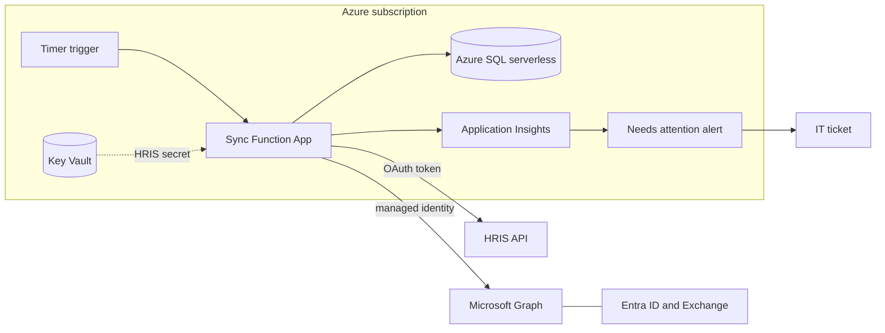

# Infrastructure Note

This is the production application I had in mind before starting on any code in the project. With all resources available this is how I would have made it. I think my proposed solution is the most cost-efficient and easiest to maintain.

## Proposed architecture

Note: The semantics of whether Graph and Entra/Exhcange Exists within the Subscription can be argued. The Figure puts resources we provisioned into the Subscription 

| Component | Role | Why |
|---|---|---|
| Function App (Python, timer trigger) | Runs one sync per schedule, for example hourly | Serverless: billed per execution, little to no. The timer is the "scheduled job" the CLI stands in for |
| Managed identity | Authenticates to Graph, Key Vault and Azure SQL | No secrets for any Azure or Microsoft service |
| Key Vault | Holds the HRIS client id and secret | The one secret a managed identity can't replace. Read through a Key Vault reference in the app settings.Doesnt need reconfiging if there is a Key Rotation |
| Azure SQL serverless | Holds the service's state and audit log | The SQLAlchemy models carry over by changing the connection string. Auto-pauses when idle to keep costs low |
| Application Insights | Collects the JSON audit lines and run results | Searchable by correlation id or employeeId |
| Alert -> ticket | Fires on a needs-attention result (exit code 2 in the CLI) | A person is told about every ManualReview and exception state |

## How a run maps to Azure

1. Function App runs the equivalent of `hris-sync sync --apply`, with no `--today`, so both clocks are the real one.
2. It gets the HRIS delivery. That's either a pull from the HRIS API with a read-scoped token, or a file the HRIS drops into Blob Storage. If nothing new arrived, the run still applies scheduled changes and checks pending mailboxes.
3. It runs the three passes against Graph and the HRIS, as in the Sequence Diagrams, saving state to Azure SQL as it goes.
4. Every decision goes to Application Insights as one JSON line.
5. If anything needs a person, the run reports it as needing attention, the alert fires, and a ticket is raised.

A crash or restart loses nothing. State lives in Azure SQL, so the next timer run carries on from the last saved stage.

## Credentials

| Access | How |
|---|---|
| Microsoft Graph | Managed identity, using `DefaultAzureCredential`. No secret |
| HRIS API | OAuth client credentials. The client id and secret come from Key Vault. Scopes are described in the Threat and Failure Note |
| Azure SQL | Managed identity with a database role. No connection-string password |
| Local development | A git-ignored `.env` connecting to a test maybe using the mock as tests for the real system. Never real credentials |

## Alternatives considered

- Linux VM with a systemd timer: runs the current CLI and SQLite unchanged, but I'd own patching, backups and a single point of failure. Worth it only if the HRIS demands a fixed outbound IP. It has a more complicated deployment setup and is more difficult to use the GraphAPI adding more developer overhead. We would own scaling out. Depending on criticality it could be 3 environments increasing costs.
- Container Apps Job: a scheduled container with managed identity and no OS to patch. More to set up than a Function App for the same result.
- Event-driven (webhook): if the HRIS can push changes, an HTTP Function would put each event on a queue, with a worker Function doing the sync and a dead-letter queue for failures. It's more responsive, but more complicated to implement, and a timer is still needed for mailbox checks and scheduled dates. For a few joiners a day, the timer design is simpler and just as correct.
